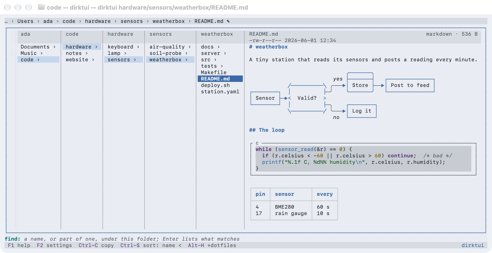
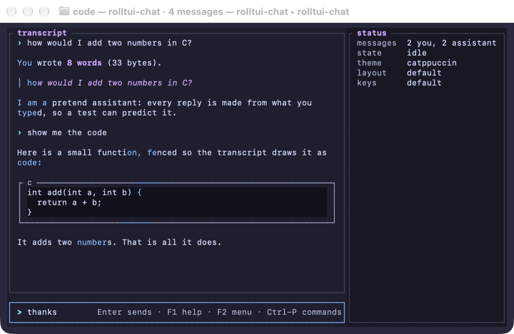
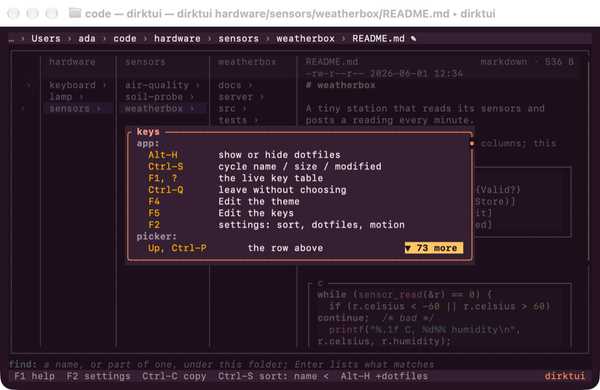

# rolltui

A terminal UI library in C, with a C++ API. Its screens, themes, keys and menus are files a person
can change; every terminal it runs on is asked what it can draw and is drawn to the answers; and a
program built on it runs with no terminal at all, so it can be tested and recorded, by you or by
your agent.

<picture>
  <source media="(prefers-color-scheme: dark)" srcset="docs/images/dirktui-dark.png">
  
</picture>

*dirktui previewing a README: a Mermaid flowchart, highlighted C, and a table.*

**[Try it in your browser](https://itscool.github.io/rolltui/)**: `rolltui-tour`, a table that sorts,
filters and marks, live charts, a page of Markdown, every theme and the vim keys, compiled to
WebAssembly and running on xterm.js. It is the same `examples/tour.c` a terminal runs. Or install the
browser above: `brew install itscool/tap/dirktui`.

## Why rolltui

- **The screen is a file.** Layouts, themes, key bindings and menus are JSON the program loads, and
  `rolltui-studio` edits them live. A person rebinds a key or moves a panel without a rebuild, and an
  agent writes a screen as data instead of as drawing code.
- **Right on terminals you never tried.** The library asks each terminal its colour depth, its
  background, how wide it draws ambiguous characters, whether it draws a frame whole, its keyboard
  protocol and how it shows pictures, remembers the answers, and draws to them: kitty, Ghostty,
  iTerm2, WezTerm, Konsole, VTE, Windows Terminal, Apple's Terminal, the Linux console, inside tmux,
  over ssh and in a browser.
- **Tested without a terminal.** `rolltui_run_begin_headless` runs a program's real loop at a size
  with no terminal: a test sends keys, presses and resizes and reads the screen back as text.
  `ROLLTUI_RECORD=demo.cast` records any run as an asciicast that asciinema plays.
- **Fast.** A 10,000-row table moving its cursor takes 0.11 ms and 163 bytes a frame, against
  ratatui's 0.64 ms and 505 bytes. [Speed](#speed) has the rest.
- **What a program needs, already in it.** Markdown with Mermaid diagrams, syntax highlighting from
  25 grammar files, pictures, tables and trees, charts, a multi-line editor, a command palette,
  toasts, dialogs, a file browser with previews, and 10 themes, each with a light and a dark side,
  checked for contrast and for colour blindness.
- **One header, nothing to install.** `rolltui.h` is the whole C API, and every pointer in it is
  OWNED, BORROWED or a VALUE. The library links only the platform's C and C++ libraries.

## Building with an agent

rolltui is written to be read by an agent and to let it check its own work. Point it at:

1. [`rolltui.h`](rolltui.h): the whole API, each function's contract beside it.
2. [`docs/guide.md`](docs/guide.md): how the parts fit, and what the library does so a program
   does not have to.
3. [`examples/tour.c`](examples/tour.c): a whole program in 690 lines of C.
4. [`docs/design.md`](docs/design.md): the rules a screen is held to, each with a test.

Then have it prove the program works. A headless run in its own test drives it and reads the
screen. `ROLLTUI_LOG=run.log ROLLTUI_LOG_LEVEL=debug` writes what the terminal answered and each
frame's time. `ROLLTUI_TIMING=1` puts each window's draw time in its border, and `ROLLTUI_RECORD`
records a run you can watch.

A prompt to start from:

> Build *the program* with rolltui (https://github.com/itscool/rolltui), added with
> `add_subdirectory`. Read `rolltui.h`, `docs/guide.md` and `examples/tour.c` first. Put the screen
> in a layout file rather than drawing code. Write an end-to-end test with
> `rolltui_run_begin_headless` that drives it with keys and checks the screen text, and record a
> demo with `ROLLTUI_RECORD=demo.cast`.

## How it compares (November 2026)

| | rolltui | Textual | ratatui | Bubble Tea | notcurses | FTXUI |
|---|---|---|---|---|---|---|
| Platforms | 🍎 🐧 🪟 🌐 | 🍎 🐧 🪟 🌐 | 🍎 🐧 🪟 🌐 | 🍎 🐧 🪟 | 🍎 🐧 (🪟) | 🍎 🐧 🪟 🌐 |
| Language | C, C++ API | Python | Rust | Go | C | C++ |
| Dependencies | none (md4c, stb_image built in) | rich, Pygments, markdown-it, … | crossterm, ~15 crates | 10+ Go modules | terminfo, libunistring, libdeflate | none |
| **Configuration** | | | | | | |
| Layouts, themes and menus as files | ✓ | stylesheets | ✗ | ✗ | ✗ | ✗ |
| Key bindings changeable without code | ✓ | ✓ | ✗ | partial | ✗ | ✗ |
| Editor app for all of it | ✓ | ✗ | ✗ | ✗ | ✗ | ✗ |
| Theme contrast and colour-blindness checks | ✓ | ✗ | ✗ | ✗ | ✗ | ✗ |
| Animation chosen by the theme | ✓ | in code | tachyonfx, in code | in code | in code | in code |
| **Content** | | | | | | |
| Markdown | ✓ | ✓ | ✗ | Glamour | ✗ | ✗ |
| Mermaid diagrams | ✓ | ✗ | ✗ | ✗ | ✗ | ✗ |
| Syntax highlighting | ✓ | ✓ | ✗ | in Glamour | ✗ | ✗ |
| File browser with live preview | ✓ | ✗ | ✗ | ✗ | ✗ | ✗ |
| Images (kitty, iTerm2, sixel, blocks) | ✓ | ✗ | ratatui-image | ✗ | ✓ | ✗ |
| **Widgets** | | | | | | |
| Data table | ✓ | ✓ | ✓ | ✓ | ✗ | partial |
| Tree | ✓ | ✓ | ✗ | ✓ | ✓ | partial |
| Tabs | ✓ | ✓ | ✓ | ✗ | ✓ | ✓ |
| Charts | ✓ | ✓ | ✓ | ✗ | ✓ | ✓ |
| Multi-line text editor | ✓ | ✓ | ratatui-textarea | ✓ | ✓ | partial |
| Progress bar and spinner | ✓ | ✓ | gauge only | ✓ | bar only | ✓ |
| Toast notifications | ✓ | ✓ | ✗ | ✗ | ✗ | ✗ |
| Command palette | ✓ | ✓ | ✗ | partial | ✗ | ✗ |
| **Terminal** | | | | | | |
| Capabilities probed and remembered per terminal | ✓ | ✗ | ✗ | probed | probed | ✗ |
| Line breaking tested against Unicode's test files | ✓ | ✗ | ✗ | ✗ | ✗ | ✗ |
| Synchronized output | ✓ | ✓ | ✗ | ✓ | ✓ | ✗ |
| Inline mode | ✓ | ✓ | ✓ | ✓ | ✓ | ✓ |
| Hyperlinks | ✓ | ✓ | ✗ | ✓ | ✗ | ✓ |
| Hover under the pointer | ✓ | ✓ | events only | events only | events only | ✓ |

🍎 macOS · 🐧 Linux · 🪟 Windows · 🌐 browser · (🪟) partial

| | |
|---|---|
|  |  |
| rolltui-chat · catppuccin | dirktui settings · solarized, light |
|  |  |
| dirktui keys · ember | rolltui-studio theme editor · orchard |
|  |  |
| dirktui code preview · harbour, light | rolltui-chat command palette · mono |

## Speed

The same screens drawn by rolltui and by ratatui 0.29. A frame is the whole of what a program does for one: drawn, compared with the last
frame, and encoded as the bytes a terminal is sent, and for the tables the key handled and the screen laid out first. 200×50 cells,
truecolor, on an Apple M5 Max:

| Screen | rolltui | ratatui |
|---|---|---|
| A 10,000-row table, the cursor moving down a row | 0.11 ms, 163 bytes | 0.64 ms, 505 bytes |
| The same table scrolling a row | 0.16 ms, 164 bytes | 0.39 ms, 2,010 bytes |
| A page of text with a counter ticking in its corner | 0.04 ms, 56 bytes | 0.42 ms, 70 bytes |

ratatui's table is given only the rows on screen, its fastest use; given all 10,000 rows, as its `Table` is usually fed, a frame
takes about 3 ms. Rows that moved are scrolled on the terminal rather than written again, the cursor takes the shortest move, a
colour change names only what changed, and a run of blanks is an erase. The test suite replays the bytes into a model of a terminal
and compares the screen with the frame, cell by cell. `tools/bench/run.sh` builds both and prints the table at 200×50 and 80×24, and
`tools/bench/frame_times.py` times a real program's frames: dirktui at 200×50 draws a frame in 0.6 ms and sends it in 0.2 ms.

## What's in the repository

- **The library**: `rolltui.h` and `c/`. `rolltui.h` is the whole public API, and everything under
  `c/` is internal. `rolltui_cpp.h` is the C++ API over it.
- **dirktui** (`examples/dirktui.cpp`): a directory browser for the shell. `dirk` browses, prints
  the chosen path, and a shell function does the rest. `brew install itscool/tap/dirktui`; on
  Windows, `dirktui install` puts `dirk` into PowerShell's profile.
- **rolltui-studio** (`tools/studio.cpp`, `rolltui_studio.h`): edits themes, layouts, key bindings
  and menus live.
- **Examples**: `rolltui-tour` (`examples/tour.c`, the browser demo), `rolltui-chat`
  (`examples/chat.cpp`), `rolltui-paint` (`examples/paint.cpp`).

## Building

Requires CMake 3.24 or later and a C++23 compiler.

```sh
cmake -B build -S .
cmake --build build -j
ctest --test-dir build
```

```sh
./build/dirktui ~/src            # the directory browser
./build/rolltui-tour             # the tour the browser demo runs
./build/rolltui-studio           # author themes, layouts, key bindings and menus
./build/rolltui-chat             # the chat screen with a pretend assistant
./build/rolltui-paint            # the text-mode painting app
```

In another project, add the repository with `add_subdirectory()` in a folder named `rolltui`, link
`rolltui`, and include `rolltui/rolltui.h`.

### Windows

The library and the programs cross-compile with MinGW-w64. The programs link their runtime in and
need nothing else installed on Windows 10 or 11. The test suite drives programs through ptys and is
off for Windows builds.

```sh
cmake -B build-windows -S . -DCMAKE_SYSTEM_NAME=Windows \
  -DCMAKE_C_COMPILER=x86_64-w64-mingw32-gcc -DCMAKE_CXX_COMPILER=x86_64-w64-mingw32-g++
cmake --build build-windows -j
```

### The browser

`tools/web/build.sh` builds `rolltui-tour` for wasm32-wasi with zig and puts it beside a page that
runs it on xterm.js; `.github/workflows/demo.yml` publishes it to the demo link above.

## Documentation

[docs/guide.md](docs/guide.md): the run loop, terminal detection, layouts at run time, keys and
sequences, the editor, lists, tables and trees, charts, dialogs, diagnostics, work off the UI
thread, other programs, pictures, previews, Markdown and Mermaid, syntax highlighting, ownership,
and embedding.

[docs/design.md](docs/design.md): the rules every screen the library ships follows, each with a
test a screen can be held to.

## License

MIT. See [LICENSE](LICENSE). Compiled into the library from `third_party/`, each under its own
licence: md4c (Markdown), stb_image (picture decoding, taken as public domain), and the Catppuccin
and Solarized palettes (two themes' colours). dirktui's release carries their notices in `NOTICE`.
