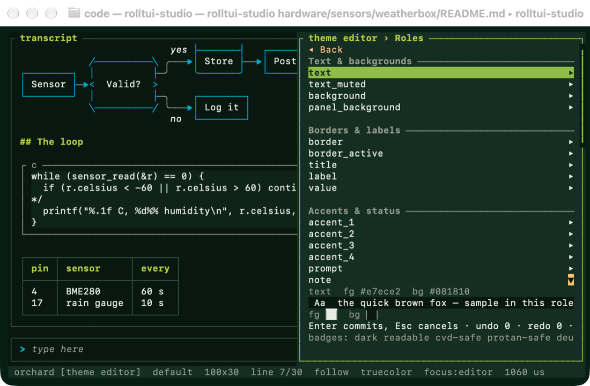
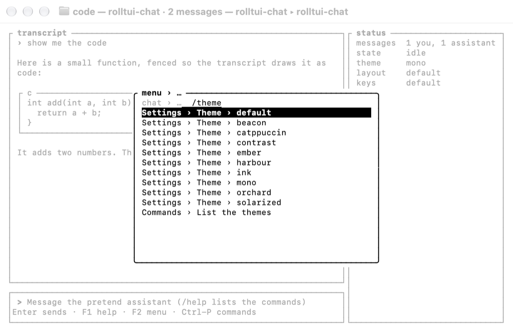

# rolltui

A terminal UI library in C, with a C++ API on top.

<picture>
  <source media="(prefers-color-scheme: dark)" srcset="docs/images/dirktui-dark.png">
  
</picture>

*dirktui previewing a README: a Mermaid flowchart, highlighted C, and a table.*

## How it compares (November 2026)

| | rolltui | Textual | ratatui | Bubble Tea | notcurses | FTXUI |
|---|---|---|---|---|---|---|
| Platforms | 🍎 🐧 🪟 | 🍎 🐧 🪟 🌐 | 🍎 🐧 🪟 🌐 | 🍎 🐧 🪟 | 🍎 🐧 (🪟) | 🍎 🐧 🪟 🌐 |
| Language | C, C++ API | Python | Rust | Go | C | C++ |
| Dependencies | none | rich, Pygments, markdown-it, … | crossterm, ~15 crates | 10+ Go modules | terminfo, libunistring, libdeflate | none |
| **Configuration** | | | | | | |
| Layouts, themes and menus as files | ✓ | stylesheets | ✗ | ✗ | ✗ | ✗ |
| Key bindings changeable without code | ✓ | ✓ | ✗ | partial | ✗ | ✗ |
| Editor app for all of it | ✓ | ✗ | ✗ | ✗ | ✗ | ✗ |
| Theme contrast and colour-blindness checks | ✓ | ✗ | ✗ | ✗ | ✗ | ✗ |
| Animation chosen by the theme | ✓ | in code | tachyonfx, in code | in code | in code | in code |
| **Content** | | | | | | |
| Markdown | ✓ | ✓ | ✗ | Glamour | ✗ | ✗ |
| Mermaid diagrams | ✓ | ✗ | ✗ | ✗ | ✗ | ✗ |
| Syntax highlighting | ✓ | ✓ | ✗ | in Glamour | ✗ | ✗ |
| File browser with live preview | ✓ | ✗ | ✗ | ✗ | ✗ | ✗ |
| Images (kitty, iTerm2, sixel, blocks) | ✓ | ✗ | ratatui-image | ✗ | ✓ | ✗ |
| **Widgets** | | | | | | |
| Data table | ✓ | ✓ | ✓ | ✓ | ✗ | partial |
| Tree | ✓ | ✓ | ✗ | ✓ | ✓ | partial |
| Tabs | ✓ | ✓ | ✓ | ✗ | ✓ | ✓ |
| Charts | ✓ | ✓ | ✓ | ✗ | ✓ | ✓ |
| Multi-line text editor | ✓ | ✓ | ratatui-textarea | ✓ | ✓ | partial |
| Progress bar and spinner | ✓ | ✓ | gauge only | ✓ | bar only | ✓ |
| Toast notifications | ✓ | ✓ | ✗ | ✗ | ✗ | ✗ |
| Command palette | ✓ | ✓ | ✗ | partial | ✗ | ✗ |
| **Terminal** | | | | | | |
| Capabilities probed and remembered per terminal | ✓ | ✗ | ✗ | probed | probed | ✗ |
| Line breaking tested against Unicode's test files | ✓ | ✗ | ✗ | ✗ | ✗ | ✗ |
| Synchronized output | ✓ | ✓ | ✗ | ✓ | ✓ | ✗ |
| Inline mode | ✓ | ✓ | ✓ | ✓ | ✓ | ✓ |
| Hyperlinks | ✓ | ✓ | ✗ | ✓ | ✗ | ✓ |
| Hover under the pointer | ✓ | ✓ | events only | events only | events only | ✓ |

🍎 macOS · 🐧 Linux · 🪟 Windows · 🌐 browser · (🪟) partial

| | |
|---|---|
|  |  |
| rolltui-chat · catppuccin | dirktui settings · solarized, light |
|  |  |
| dirktui keys · ember | rolltui-studio theme editor · orchard |
|  |  |
| dirktui code preview · harbour, light | rolltui-chat command palette · mono |

## Speed

The same screens drawn by rolltui and by ratatui 0.29. A frame is the whole of what a program does for one: drawn, compared with the last
frame, and encoded as the bytes a terminal is sent, and for the tables the key handled and the screen laid out first. 200×50 cells,
truecolor, on an Apple M5 Max:

| Screen | rolltui | ratatui |
|---|---|---|
| A 10,000-row table, the cursor moving down a row | 0.11 ms, 163 bytes | 0.64 ms, 505 bytes |
| The same table scrolling a row | 0.16 ms, 164 bytes | 0.39 ms, 2,010 bytes |
| A page of text with a counter ticking in its corner | 0.04 ms, 56 bytes | 0.42 ms, 70 bytes |

ratatui's table is given only the rows on screen, its fastest use; given all 10,000 rows, as its `Table` is usually fed, a frame
takes about 3 ms. Rows that moved are scrolled on the terminal rather than written again, the cursor takes the shortest move, a
colour change names only what changed, and a run of blanks is an erase. The test suite replays the bytes into a model of a terminal
and compares the screen with the frame, cell by cell. `tools/bench/run.sh` builds both and prints the table at 200×50 and 80×24.

## What's in the repository

- **The library**: `rolltui.h` and `c/`. `rolltui.h` is the whole public API, and everything under
  `c/` is internal. Every pointer is OWNED, BORROWED or a plain VALUE, and there is no `shared_ptr`.
- **dirktui** (`examples/dirktui.cpp`): a directory browser for the shell. `dirk` browses, prints
  the chosen path, and a shell function does the rest. `brew install itscool/tap/dirktui`; on
  Windows, `dirktui install` puts `dirk` into PowerShell's profile.
- **rolltui-studio** (`tools/studio.cpp`, `rolltui_studio.h`): edits themes, layouts, key bindings
  and menus live.
- **Examples**: `rolltui-chat` (`examples/chat.cpp`), `rolltui-paint` (`examples/paint.cpp`).

## Building

Requires CMake 3.24 or later and a C++23 compiler.

```sh
cmake -B build -S .
cmake --build build -j
ctest --test-dir build
```

```sh
./build/dirktui ~/src            # the directory browser
./build/rolltui-studio           # author themes, layouts, key bindings and menus
./build/rolltui-chat             # the chat screen with a pretend assistant
./build/rolltui-paint            # the text-mode painting app
```

### Windows

The library and the programs cross-compile with MinGW-w64. The programs link their runtime in and
need nothing else installed on Windows 10 or 11. The test suite drives programs through ptys and is
off for Windows builds.

```sh
cmake -B build-windows -S . -DCMAKE_SYSTEM_NAME=Windows \
  -DCMAKE_C_COMPILER=x86_64-w64-mingw32-gcc -DCMAKE_CXX_COMPILER=x86_64-w64-mingw32-g++
cmake --build build-windows -j
```

## Documentation

[docs/guide.md](docs/guide.md): strings, terminal detection, the run loop, file watching,
previews, Mermaid diagrams, syntax highlighting and grammar files, ownership, and embedding.

## License

MIT. See [LICENSE](LICENSE). Vendored under `third_party/`, each under its own licence: md4c
(Markdown), stb_image (PNG decoding in rolltui-paint), and the Catppuccin and Solarized palettes.
