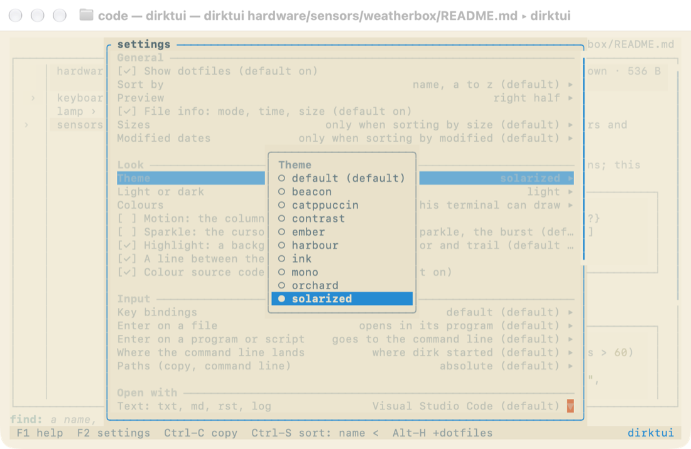

# rolltui

A terminal UI library in C, with a C++ wrapper.

Screens, themes, key bindings and menus are JSON files loaded at runtime. On startup rolltui asks
the terminal about colour depth, background colour, keyboard protocol, image support and a few
other things, caches the answers, and renders to match. The event loop can also run headless, which
is how the test suite drives programs.

<picture>
  <source media="(prefers-color-scheme: dark)" srcset="docs/images/dirktui-dark.png">
  
</picture>

*dirktui previewing a README with a Mermaid flowchart, highlighted C and a table.*

Live demo: <https://itscool.github.io/rolltui/> (`examples/tour.c` compiled to wasm, running in
xterm.js). The file browser in the screenshot is on Homebrew: `brew install itscool/tap/dirktui`.

## Features

- JSON layouts, themes, key bindings and menus, editable live in `rolltui-studio`
- Terminal capability detection, cached per terminal: kitty, Ghostty, iTerm2, WezTerm, Konsole, VTE
  terminals, Windows Terminal, Terminal.app and the Linux console, also under tmux, screen, Zellij
  and ssh
- Headless runs for end-to-end tests (`rolltui_run_begin_headless`) and asciinema recordings of any
  run (`ROLLTUI_RECORD=demo.cast`)
- Markdown with Mermaid diagrams, syntax highlighting, images (kitty, iTerm2, sixel or half
  blocks), tables and trees, charts, count panels, a multi-line editor with completion, a command
  palette, toasts, dialogs, and a file browser with previews and `LS_COLORS`
- Panes resized by dragging their edges, where the layout allows it
- 10 themes with light and dark variants, checked for contrast and colour blindness
- The words the library draws, the key help included, can be translated with a texts file
- Fast; see [Speed](#speed)
- No dependencies beyond a C and C++ compiler. The C API is one header, `rolltui.h`

## Working with coding agents

Point the agent at [docs/guide.md](docs/guide.md) first ("How the parts fit" and "A first program"
are the place to start), then [rolltui.h](rolltui.h) for the API and
[examples/tour.c](examples/tour.c) for a full program. [tests/hello_test.c](tests/hello_test.c) is
the pattern for a headless test. For debugging, `ROLLTUI_LOG=run.log ROLLTUI_LOG_LEVEL=debug` logs
the terminal's replies and frame times, and `ROLLTUI_TIMING=1` shows draw times in window borders.

A starting prompt:

> Build *the program* with rolltui (https://github.com/itscool/rolltui), added with
> `add_subdirectory`. Read docs/guide.md, rolltui.h and examples/tour.c. Put the screen in a layout
> file. Add an end-to-end test with `rolltui_run_begin_headless` like tests/hello_test.c, and record
> a demo with `ROLLTUI_RECORD=demo.cast`.

## How it compares (November 2026)

| | rolltui | Textual | ratatui | Bubble Tea | notcurses | FTXUI |
|---|---|---|---|---|---|---|
| Platforms | 🍎 🐧 🪟 🌐 | 🍎 🐧 🪟 🌐 | 🍎 🐧 🪟 🌐 | 🍎 🐧 🪟 | 🍎 🐧 (🪟) | 🍎 🐧 🪟 🌐 |
| Language | C, C++ API | Python | Rust | Go | C | C++ |
| Dependencies | none (md4c, stb_image built in) | rich, Pygments, markdown-it, … | crossterm, ~15 crates | 10+ Go modules | terminfo, libunistring, libdeflate | none |
| **Configuration** | | | | | | |
| Layouts, themes and menus as files | ✓ | stylesheets | ✗ | ✗ | ✗ | ✗ |
| Key bindings changeable without code | ✓ | ✓ | ✗ | partial | ✗ | ✗ |
| Editor app for all of it | ✓ | ✗ | ✗ | ✗ | ✗ | ✗ |
| Theme contrast and colour-blindness checks | ✓ | ✗ | ✗ | ✗ | ✗ | ✗ |
| Animation chosen by the theme | ✓ | in code | tachyonfx, in code | in code | in code | in code |
| **Content** | | | | | | |
| Markdown | ✓ | ✓ | ✗ | Glamour | ✗ | ✗ |
| Mermaid diagrams | ✓ | ✗ | ✗ | ✗ | ✗ | ✗ |
| Syntax highlighting | ✓ | ✓ | ✗ | in Glamour | ✗ | ✗ |
| File browser with live preview | ✓ | ✗ | ✗ | ✗ | ✗ | ✗ |
| Images (kitty, iTerm2, sixel, blocks) | ✓ | ✗ | ratatui-image | ✗ | ✓ | ✗ |
| **Widgets** | | | | | | |
| Data table | ✓ | ✓ | ✓ | ✓ | ✗ | partial |
| Tree | ✓ | ✓ | ✗ | ✓ | ✓ | partial |
| Tabs | ✓ | ✓ | ✓ | ✗ | ✓ | ✓ |
| Charts | ✓ | ✓ | ✓ | ✗ | ✓ | ✓ |
| Multi-line text editor | ✓ | ✓ | ratatui-textarea | ✓ | ✓ | partial |
| Progress bar and spinner | ✓ | ✓ | gauge only | ✓ | bar only | ✓ |
| Toast notifications | ✓ | ✓ | ✗ | ✗ | ✗ | ✗ |
| Command palette | ✓ | ✓ | ✗ | partial | ✗ | ✗ |
| **Terminal** | | | | | | |
| Capabilities probed and remembered per terminal | ✓ | ✗ | ✗ | probed | probed | ✗ |
| Line breaking tested against Unicode's test files | ✓ | ✗ | ✗ | ✗ | ✗ | ✗ |
| Synchronized output | ✓ | ✓ | ✗ | ✓ | ✓ | ✗ |
| Inline mode | ✓ | ✓ | ✓ | ✓ | ✓ | ✓ |
| Hyperlinks | ✓ | ✓ | ✗ | ✓ | ✗ | ✓ |
| Hover under the pointer | ✓ | ✓ | events only | events only | events only | ✓ |

🍎 macOS · 🐧 Linux · 🪟 Windows · 🌐 browser · (🪟) partial

| | |
|---|---|
|  |  |
| rolltui-chat · catppuccin | dirktui settings · solarized, light |
|  |  |
| dirktui keys · ember | rolltui-studio theme editor · orchard |
|  |  |
| dirktui code preview · harbour, light | rolltui-chat command palette · mono |

## Speed

Same screens in rolltui and ratatui 0.29. A frame covers key handling, layout, drawing, diffing
against the previous frame and encoding the output. 200×50, truecolor, Apple M5 Max:

| Screen | rolltui | ratatui |
|---|---|---|
| A 10,000-row table, the cursor moving down a row | 0.11 ms, 163 bytes | 0.64 ms, 505 bytes |
| The same table scrolling a row | 0.16 ms, 164 bytes | 0.39 ms, 2,010 bytes |
| A page of text with a counter ticking in its corner | 0.04 ms, 56 bytes | 0.42 ms, 70 bytes |

ratatui's table only gets the visible rows here, which is its fastest case. Fed all 10,000 rows, as
`Table` usually is, it takes about 3 ms a frame. rolltui scrolls moved rows on the terminal instead
of rewriting them, uses the shortest cursor moves, only sends attributes that changed and erases
runs of blanks. The test suite replays the output into a terminal model and compares it with the
frame cell by cell.

To reproduce, run `tools/bench/run.sh` (it prints 200×50 and 80×24). `tools/bench/frame_times.py`
times a real program: dirktui at 200×50 draws a frame in 0.6 ms and sends it in 0.2 ms.

## Repository

- `rolltui.h`, `c/`: the library. `rolltui.h` is the public C API, `c/` is internal and
  `rolltui_cpp.h` is the C++ wrapper. Pointers are OWNED, BORROWED or plain VALUEs; there is no
  `shared_ptr`.
- `examples/dirktui.cpp`: dirktui, a directory browser for the shell. `dirk` opens it and hands the
  chosen path back to the shell. `brew install itscool/tap/dirktui`, or on Windows run
  `dirktui install` to add `dirk` to your PowerShell profile.
- `tools/studio.cpp`: rolltui-studio, an editor for themes, layouts, key bindings and menus.
- `examples/`: also hello (the guide's first program), tour (the web demo), chat and paint.

## Building

Needs CMake 3.24+ and a C++23 compiler.

```sh
cmake -B build -S .
cmake --build build -j
ctest --test-dir build
```

```sh
./build/dirktui ~/src            # directory browser
./build/rolltui-hello            # the guide's first program
./build/rolltui-tour             # the web demo, in the terminal
./build/rolltui-studio           # theme, layout, key and menu editor
./build/rolltui-chat             # chat screen with a pretend assistant
./build/rolltui-paint            # text-mode paint program
```

To use it in another project, clone or submodule it into a folder named `rolltui`, call
`add_subdirectory()`, link `rolltui` and include `rolltui/rolltui.h`.

### Windows

Cross-compiles with MinGW-w64. The binaries are statically linked and run on Windows 10 and 11 as
they are. The tests need pseudo-terminals, so they're off for Windows builds.

```sh
cmake -B build-windows -S . -DCMAKE_SYSTEM_NAME=Windows \
  -DCMAKE_C_COMPILER=x86_64-w64-mingw32-gcc -DCMAKE_CXX_COMPILER=x86_64-w64-mingw32-g++
cmake --build build-windows -j
```

### Web

`tools/web/build.sh` builds the tour for wasm32-wasi with zig. `.github/workflows/demo.yml` deploys
it to the demo site.

## Docs

- [docs/guide.md](docs/guide.md): how the parts fit, a first program and its test, the layout,
  menu and key binding file formats, then each part of the library. A test keeps it in sync with
  the code.
- [docs/design.md](docs/design.md): the rules the built-in screens follow.

## License

MIT (see [LICENSE](LICENSE)). Bundled in `third_party/` under their own licences: md4c (Markdown),
stb_image (image decoding, used under its public-domain option), and the Catppuccin and Solarized
palettes. dirktui releases ship their notices in `NOTICE`.
