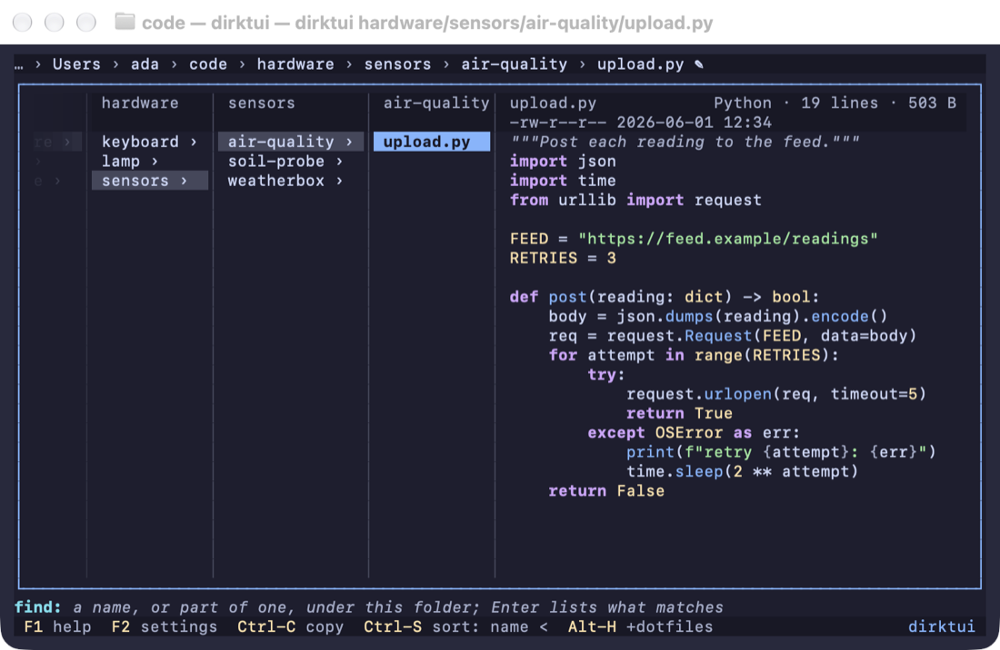
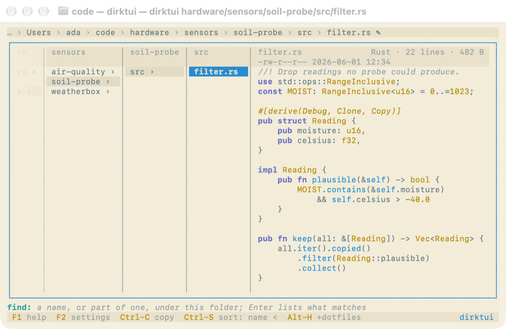
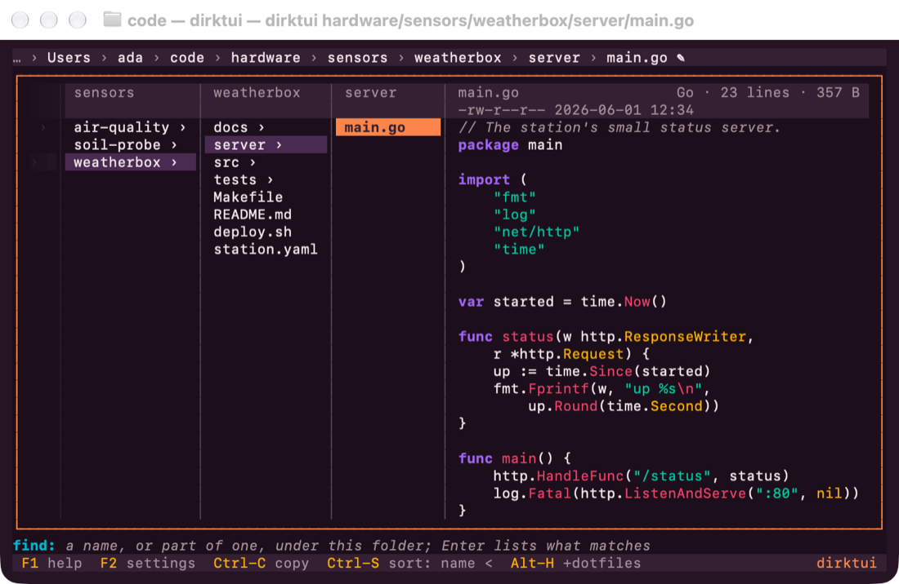
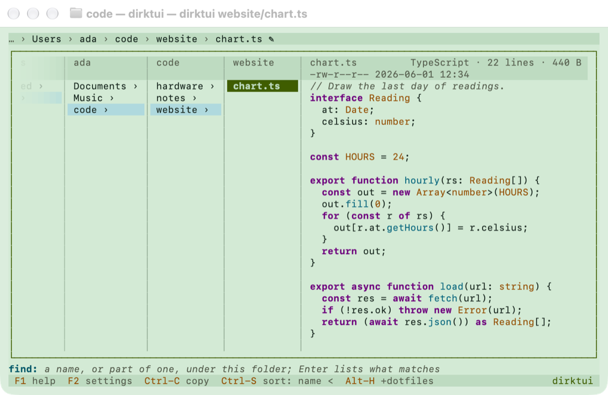
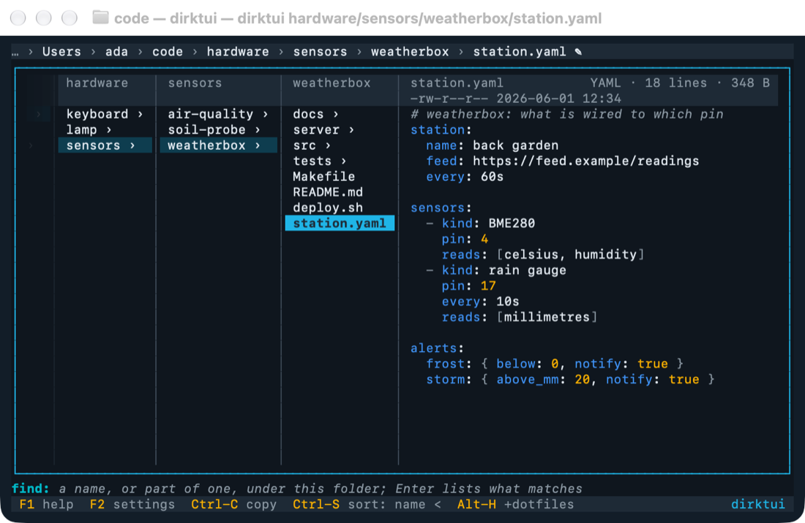
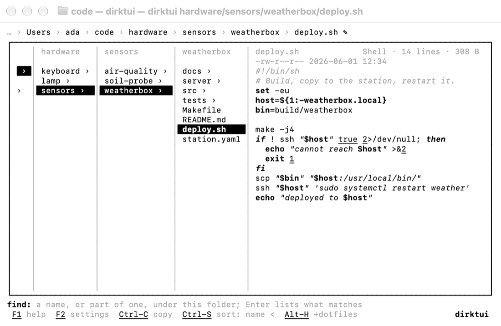

# rolltui

A small terminal-UI library in C, with a C++ shape for consumers who want one.

<picture>
  <source media="(prefers-color-scheme: dark)" srcset="docs/images/dirktui-dark.png">
  
</picture>

*dirktui, a directory browser built on rolltui, previewing a README. The flowchart is Mermaid
source drawn in box-drawing characters, and the C is coloured by a grammar file.*

## What it does well

- **A screen is data.** Themes, key bindings, layouts and menus are JSON files a person can read
  and edit, and `rolltui-studio` edits them live, with undo and a contrast check. Ten themes ship,
  each with a light side and a dark side. Light or dark, and the colour depth, are the person's
  settings, kept when they change theme.
- **Text is measured, not guessed.** Line breaking (UAX #14), grapheme clusters and word
  boundaries (UAX #29) and display width come from Unicode 17.0's own data, and the suite replays
  Unicode's conformance files for all three.
- **The terminal is asked what it is.** How many colours it draws, whether its background is light
  or dark, how wide it draws an ambiguous glyph: found out in the same round trip that sets up the
  keyboard, remembered per terminal, and applied by the library, so no app has to ask. A terminal
  that answers costs under a millisecond.
- **Frames have budgets, and tests hold them.** A steady 120×40 frame allocates nothing, and a
  frame that streams new text re-lays only the entry that changed. `rolltui-budget-test` measures
  both and fails on a regression.
- **Rich content comes built in.** Markdown (headings, lists, tables, code boxes); Mermaid diagrams
  (flowcharts, sequence, state, class and ER diagrams, mind maps, timelines, journeys, Gantt and pie
  charts); colour for 27 languages and file formats from grammar files you can add to; and a column
  file browser whose preview keeps up with the disk.
- **Every theme reads, mono included.** Kinds of text differ by bold, italic, underline and dim as
  well as by colour, so `mono`, which has no colours at all, still tells a keyword from a comment.
- **C underneath, C++ when you want it.** `rolltui.h` is the whole public API and compiles as plain
  C. `rolltui_cpp.h` and `rolltui/str.hpp` give a C++ host classes and a string toolkit over the
  same data.
- **Ownership is written down.** Every pointer is OWNED (one owner, freed by a named `_free`
  function), BORROWED (never owns, never frees) or a VALUE (copied). `rolltui-ownership-test`
  checks each one, and there is no `shared_ptr` anywhere: every lifetime is structural.

| | |
|---|---|
|  |  |
| catppuccin, dark · Python | solarized, light · Rust |
|  |  |
| ember, dark · Go | orchard, light · TypeScript |
|  |  |
| harbour, dark · YAML | mono · shell |

*Six of the ten shipped themes and six of the 27 languages.*

## What's in the repository

- **The library**: `rolltui.h` and `c/`. `rolltui.h` is the whole public API, and everything under
  `c/` is internal. `rolltui_studio.h` adds the authoring calls only the studio needs.
- **dirktui** (`examples/dirktui.cpp`): a directory browser for the shell, in the spirit of
  `zoxide` or `atuin`. `dirk` browses, prints the chosen path, and a shell function does the rest.
  Signed, notarized, and on Homebrew: `brew install itscool/tap/dirktui`.
- **rolltui-studio** (`tools/studio.cpp`): edits rolltui's own screens (themes, layouts, key
  bindings and menus) live.
- **rolltui-chat** (`examples/chat.cpp`): a chat screen with a pretend assistant whose replies
  stream in from another thread. It writes its own loop from the terminal primitives, so it is the
  example to start from for an app with threads of its own.
- **rolltui-paint** (`examples/paint.cpp`): a text-mode painting app, proof that the library serves
  apps that are not shaped like a chat.
- **tests/**: the suite, including `c_consumer_test.c`, a program compiled as plain C to prove the
  public header needs nothing else.

## Building

Needs CMake 3.24 or later and a C++23 compiler; `rolltui-paint` also needs the system zlib for its
PNG decoder.

```sh
cmake -B build -S .
cmake --build build -j
ctest --test-dir build
```

```sh
./build/dirktui ~/src            # the directory browser
./build/rolltui-studio           # author themes, layouts, key bindings and menus
./build/rolltui-chat             # the chat screen with a pretend assistant
./build/rolltui-paint            # the text-mode painting app
```

## Going further

[docs/guide.md](docs/guide.md) covers how each part works: the string type, how the terminal is
found out, the run loop, how the file browser watches the disk, previews and diagrams, source
colouring and writing a grammar of your own, ownership, and embedding rolltui in another project.

## License

MIT. See [LICENSE](LICENSE). Vendored under `third_party/`, each with its own licence: md4c, the
Markdown parser, and the Catppuccin and Solarized palettes two of the themes are built on.
